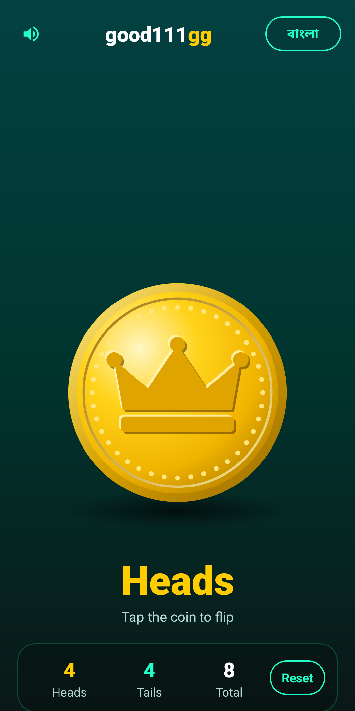
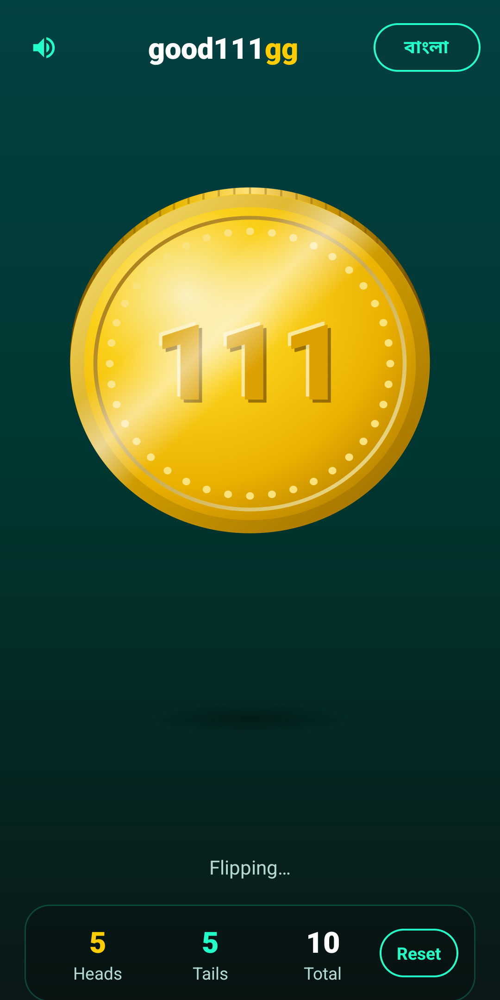
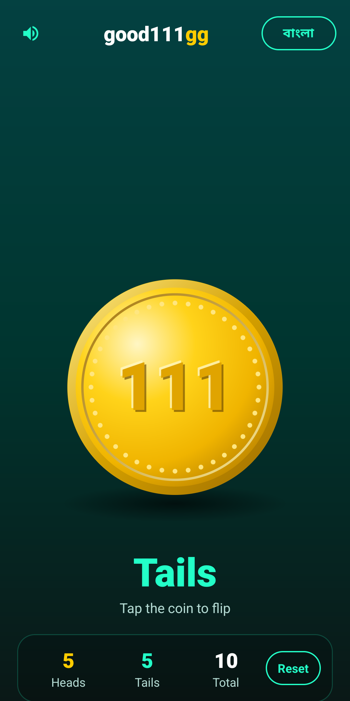
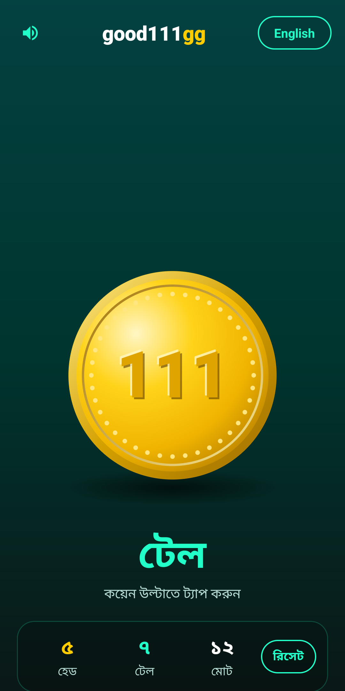

<p align="center">
  
</p>

# good111gg: Coin Flip

A clean, simple coin flipper for Android. Tap the coin and watch it spin into the air, land with a metallic ping and settle on Heads or Tails.

<p align="center">
  
  
  
  
</p>

## Features

- Realistic toss: spin, arc, bounce and shadow, drawn on a Canvas
- Fair 50/50 result (`SecureRandom`)
- Coin sounds synthesised at runtime, vibration on landing, mute toggle
- Heads / Tails / total tally, kept between sessions
- English and Bengali (বাংলা), switchable in the app
- No permissions, no network access, no ads, no tracking, no third-party libraries

## Download

- [Latest APK on GitHub Releases](https://github.com/anacodea777/good111gg/releases/latest)

## Build

Requires JDK 17 and the Android SDK (platform 36).

```
./gradlew assembleRelease
```

Without a `keystore.properties` file the release APK is built unsigned.

## Privacy

The app collects no data. See the [privacy policy](https://anacodea777.github.io/good111gg/).

## License

[MIT](LICENSE)
